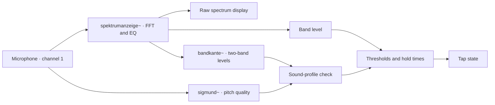

# Water Usage Sonification

A Pure Data project for sonifying a water tap’s usage over the course of a day. The current prototype detects whether the tap is running from a live microphone signal and displays its state and spectrum. Daily logging and sonification are planned.

This is a group project for *Sonic Interaction Design*, taught by Katharina Groß-Vogt at IEM/KUG.

## Getting started

1. Install [Pure Data Vanilla](https://msp.ucsd.edu/software.html). See [Dependencies](DEPENDENCIES.md) for the verified version and platform.
2. Download and extract the repository ZIP, or clone it with Git. Open [`Wasserhahn.pd`](Wasserhahn.pd) in Pd.

   ```sh
   git clone https://github.com/youngZwiebelandtheGemuseBeat/water_usage_sonification.git
   cd water_usage_sonification
   ```

3. Click **Audio-Einstellungen** in the patch. Select a microphone and make it available on input channel 1. If macOS prompts for microphone access, allow it for Pd.
4. Turn on **DSP** in the patch. The status display reads **AUS** when the tap is detected as off, **EIN** when it is detected as running, and **PAUSE** when DSP is off.

## Calibrating the detector

- Compare the **Bandpegel** with the tap closed and with a weak stream. Set the **EIN** and **AUS** thresholds between those readings, with **EIN** above **AUS**. The defaults are −45 and −50 dBFS.
- The detector checks energy across two frequency bands and how strongly pitched the raw microphone signal is. It switches on after 300 ms at or above the **EIN** threshold with the expected sound profile. It switches off after 350 ms at or below the **AUS** threshold or when the sound profile stays unsuitable for that long.
- Adjust the high- and low-pass frequencies to redraw the EQ curve, or draw on the curve with Edit Mode off. **Startwerte** restores the default cutoff frequencies (1,300 and 9,700 Hz) and thresholds.

The patch uses one audio input and has no audio output. It reports a binary state from sound. Flow rate and water volume are outside the current prototype.

## Checking the detector

After calibration, use this checklist at the tap.

- [ ] With the tap closed, the display reads **AUS**.
- [ ] With a weak, steady stream, the display changes to **EIN**. After closing the tap, it returns to **AUS**.
- [ ] Brief background noise with the tap closed leaves the display at **AUS**.
- [ ] With DSP off, the display reads **PAUSE**.

## Signal flow



## Project files

| File | Purpose |
| --- | --- |
| [`Wasserhahn.pd`](Wasserhahn.pd) | Main patch with microphone input, calibration controls, and tap state display. |
| [`abstractions/spektrumanzeige~.pd`](abstractions/spektrumanzeige~.pd) | Hann-windowed FFT with 2,048 samples and 4× overlap for the detection EQ and spectrum display. |
| [`abstractions/bandkante~.pd`](abstractions/bandkante~.pd) | Second-order Butterworth filter used to split the signal into two bands. |
| [`docs/wasserhahn-signalfluss.html`](docs/wasserhahn-signalfluss.html) | German signal-flow diagram and timing example. Open the local file in a browser. |
| [`CHANGELOG.md`](CHANGELOG.md) | Changes to the project by release. |

## Authors

Luca Candussi, Stefano Motta, and Melina Daniela Trummer.

## License

[MIT License](LICENSE).
